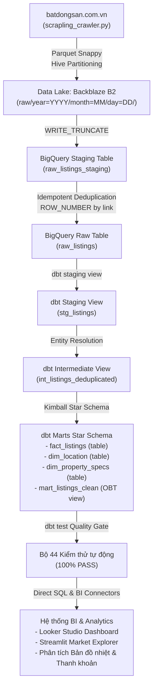

# 🏙️ HCMC Real Estate Modern Data Platform & Full-Stack Analytics (DE + DA)

[](https://github.com/Loc2116/Hcmc-Real-estate-Analytic-engineer/actions/workflows/elt_pipeline.yml)
[](https://www.python.org/downloads/)
[](https://www.getdbt.com/)
[](https://cloud.google.com/bigquery)
[](https://www.backblaze.com/b2)
[-brightgreen.svg)](https://github.com/Loc2116/Hcmc-Real-estate-Analytic-engineer)
[](https://hcmc-real-estate-analytic-engineer-eoor2dhqd9taqjfxqv2peu.streamlit.app/)

> **A Production-Grade, End-to-End Modern Data Platform & Analytics Engineering Project** for Crawling, Storing, Modeling, Testing, and Visualizing Ho Chi Minh City Real Estate Market Data.
>
> 🔗 **Live Interactive Dashboard:** [HCMC Real Estate Market Intelligence (Streamlit Cloud)](https://hcmc-real-estate-analytic-engineer-eoor2dhqd9taqjfxqv2peu.streamlit.app/)

---

## 📌 MỤC LỤC
1. [Giới Thiệu & Bài Toán Nghiệp Vụ (Executive Summary)](#1-giới-thiệu--bài-toán-nghiệp-vụ-executive-summary)
2. [Kiến Trúc Tổng Thể Hệ Thống (ELT Architecture)](#2-kiến-trúc-tổng-thể-hệ-thống-elt-architecture)
3. [Điểm Sáng Kỹ Thuật (Key Engineering Highlights)](#3-điểm-sáng-kỹ-thuật-key-engineering-highlights)
4. [Mô Hình Hóa Dữ Liệu Star Schema (Kimball Modeling)](#4-mô-hình-hóa-dữ-liệu-star-schema-kimball-modeling)
5. [Chất Lượng Dữ Liệu & Kiểm Thử Tự Động (Data Quality Gate)](#5-chất-lượng-dữ-liệu--kiểm-thử-tự-động-data-quality-gate)
6. [Tự Động Hóa & Điều Phối Pipeline (CI/CD Orchestration)](#6-tự-động-hóa--điều-phối-pipeline-cicd-orchestration)
7. [Tech Stack](#7-tech-stack)
8. [Hướng Dẫn Tái Lập (Quickstart Guide)](#8-hướng-dẫn-tái-lập-quickstart-guide)
9. [Cấu Trúc Thư Mục Dự Án](#9-cấu-trúc-thư-mục-dự-án)

---

## 1. GIỚI THIỆU & BÀI TOÁN NGHIỆP VỤ (EXECUTIVE SUMMARY)

Thị trường Bất động sản (BĐS) TP.HCM có giá trị giao dịch lớn nhưng dữ liệu niêm yết trực tuyến phân tán, nhiều tin rác và đặc biệt là tình trạng **nhiều môi giới cùng rao bán một căn nhà vật lý với mức giá và mô tả khác nhau**. 

Dự án này được thiết kế và xây dựng theo chuẩn **Modern Data Stack** bởi một **Full-Stack Analytics Professional (Data Engineer & Analytics Engineer)** nhằm:
- **Tự động hóa luồng dữ liệu (ELT Pipeline):** Thu thập dữ liệu tin đăng BĐS tự động, chống chặn, lưu trữ Data Lake chuẩn Hive phân vùng, nạp Idempotent vào Data Warehouse và tự động chuyển đổi mô hình dữ liệu.
- **Giải quyết bài toán Entity Resolution:** Tạo "vân tay số" vật lý (`property_fingerprint`) để gộp trùng các tin đăng chéo giữa nhiều môi giới, phái sinh chỉ số thanh khoản thị trường.
- **Mô hình hóa Kimball Star Schema:** Thiết kế tầng Marts đa chiều tối ưu cho Business Intelligence và phân tích thị trường (đơn giá/m², biên độ chênh lệch mặt tiền vs hẻm, tương quan diện tích - giá).
- **Đảm bảo chất lượng dữ liệu 100%:** Kiểm thử tự động 44 tests (Generic & Singular SQL tests) ngăn chặn dữ liệu bẩn vào báo cáo.

---

## 2. KIẾN TRÚC TỔNG THỂ HỆ THỐNG (ELT ARCHITECTURE)

Hệ thống tuân thủ mô hình **ELT (Extract - Load - Transform)** chia tách độc lập giữa tầng lưu trữ Data Lake, kho dữ liệu phân tích Data Warehouse và tầng chuyển đổi dữ liệu:



---

## 3. ĐIỂM SÁNG KỸ THUẬT (KEY ENGINEERING HIGHLIGHTS)

### 🔹 3.1. Crawler Kháng Chặn & Cơ Chế Đồng Bộ Checkpoint 2 Chiều
- **Chống chặn & Kháng lỗi:** Tích hợp `curl_cffi` giả lập chữ ký trình duyệt (Browser TLS Impersonation) vượt qua Cloudflare/WAF mà không cần headless browser nặng nề; kết hợp thư viện `tenacity` retry tự động với Exponential Backoff.
- **Đồng bộ Checkpoint trên Stateless CI/CD:** GitHub Actions runner là môi trường xóa sạch ổ cứng sau mỗi lần chạy. Crawler tự động tải file `state/state.json` từ Backblaze B2 về nạp danh sách URL/ID đã quét trước khi cào, và đẩy file checkpoint mới nhất ngược lên B2 sau khi kết thúc $\rightarrow$ **Tránh cào trùng lặp 100% qua các ngày**.

### 🔹 3.2. Idempotent Ingestion Pattern trên BigQuery Sandbox
- Tương thích hoàn toàn với giới hạn miễn phí của Google BigQuery Sandbox (không hỗ trợ câu lệnh DML `MERGE` partition).
- Quy trình 3 bước: Nạp batch dữ liệu vào `raw_listings_staging` (`WRITE_TRUNCATE`) $\rightarrow$ Khử trùng và cập nhật bảng chính `raw_listings` bằng `CREATE OR REPLACE TABLE ... ROW_NUMBER() OVER (PARTITION BY link ORDER BY crawled_at DESC) = 1` $\rightarrow$ Xóa bảng staging tạm.

### 🔹 3.3. Entity Resolution — Khử Trùng Lặp Chéo Môi Giới (Broker Deduplication)
- Nhiều môi giới cùng đăng bán một căn nhà dẫn đến méo mó số liệu thống kê.
- Tầng Intermediate sử dụng hàm băm `FARM_FINGERPRINT(CONCAT(...))` kết hợp: `listing_type`, `district`, `ward`, `street`, `area_m2`, `floors`, `bedrooms`, `price_billion_vnd` để nhận diện căn nhà vật lý.
- Phái sinh thước đo `duplicate_broker_count` (số lượng môi giới cùng rao bán căn nhà) — một proxy quan trọng phản ánh áp lực bán và thanh khoản của bất động sản.

---

## 4. MÔ HÌNH HÓA DỮ LIỆU STAR SCHEMA (KIMBALL MODELING)

Dữ liệu được tổ chức theo kiến trúc **Medallion & Kimball Dimensional Modeling**, 100% tên cột bằng tiếng Anh `snake_case` chuẩn công nghiệp:

```text
               ┌────────────────────────┐
               │      dim_location      │
               ├────────────────────────┤
               │ PK  location_key       │
               │     district           │
               │     ward               │
               │     street             │
               └───────────┬────────────┘
                           │ 1:N
                           │
┌──────────────────────────┴─────────────┐         ┌────────────────────────┐
│             fact_listings              │         │   dim_property_specs   │
├────────────────────────────────────────┤         ├────────────────────────┤
│ PK  listing_id                         │ N:1     │ PK  property_spec_key  │
│ FK  location_key                       ├─────────┤     lane_type          │
│ FK  property_spec_key                  │         │     legal_status       │
│     link                               │         │     furniture_status   │
│     crawled_at / crawled_date          │         └────────────────────────┘
│     price_billion_vnd                  │
│     area_m2                            │
│     price_per_m2                       │
│     lane_width_m                       │
│     frontage_m                         │
│     floors / bedrooms / bathrooms      │
│     duplicate_broker_count             │
│     is_lane_type_missing               │
│     is_lane_width_missing              │
└────────────────────────────────────────┘
```

- **`fact_listings` (materialized: `table`):** Lưu trữ các độ đo kinh doanh (giá, diện tích, đơn giá/m², chiều rộng đường, số tầng, số phòng, chỉ số trùng lặp môi giới).
- **`dim_location` (materialized: `table`):** Quản lý thứ nguyên địa giới hành chính (Quận, Phường, Đường). Khóa chính hash từ `district | ward | street`.
- **`dim_property_specs` (materialized: `table`):** Quản lý thứ nguyên đặc tính pháp lý & quy cách (Loại đường vào, Tình trạng pháp lý, Mức độ nội thất).
- **`mart_listings_clean` (materialized: `view`):** Bảng phẳng hợp nhất (One Big Table view) kết hợp bảng Fact và 2 bảng Dims phục vụ trực tiếp cho BI Dashboard và phân tích thống kê.

---

## 5. CHẤT LƯỢNG DỮ LIỆU & KIỂM THỬ TỰ ĐỘNG (DATA QUALITY GATE)

Dự án thiết lập bộ kiểm thử toàn vẹn dữ liệu tự động gồm **44 tests (100% PASS)** chạy qua `dbt test`:

1. **Khóa chính & Tính duy nhất (`unique`):** Đảm bảo không trùng lặp khóa chính trên `listing_id`, `location_key`, `property_spec_key`.
2. **Trường bắt buộc (`not_null`):** Đảm bảo các chỉ số đo lường cốt lõi (giá, diện tích, đơn giá, thời gian) không bị thiếu khuyết.
3. **Toàn vẹn tham chiếu (`relationships`):** Đảm bảo 100% khóa ngoại trong `fact_listings` trỏ chính xác đến các bản ghi tồn tại trong `dim_location` và `dim_property_specs`.
4. **Miền giá trị hợp lệ (`accepted_values`):** Ràng buộc giá trị phân loại danh mục (`'Mặt tiền'`, `'Hẻm ô tô'`, `'Hẻm xe máy'`, `'Chưa xác định'`).
5. **Kiểm thử logic nghiệp vụ (Singular SQL Tests):**
   - `assert_positive_price_and_area`: Kiểm tra giá niêm yết, diện tích và đơn giá luôn dương ($> 0$).
   - `assert_valid_hcmc_price_range`: Loại bỏ giá trị phi thực tế trên thị trường BĐS TP.HCM (diện tích $\in [10, 2000]\text{ m}^2$, đơn giá $\in [10, 1000]\text{ triệu VNĐ/m}^2$).

---

## 6. TỰ ĐỘNG HÓA & ĐIỀU PHỐI PIPELINE (CI/CD ORCHESTRATION)

Pipeline ELT được tự động hóa hoàn toàn thông qua **GitHub Actions** ([`.github/workflows/elt_pipeline.yml`](.github/workflows/elt_pipeline.yml)):

- **Lập lịch tự động (`schedule`):** Chạy định kỳ vào **02:00 sáng (UTC+7)** hằng ngày (`cron: '0 19 * * *'` UTC).
- **Kích hoạt thủ công (`workflow_dispatch`):** Hỗ trợ nút bấm chạy trực tiếp từ giao diện GitHub với tùy chọn điều chỉnh số lượng tin cào (`crawler_samples`).
- **Bảo mật thông tin:** Sử dụng GitHub Secrets để quản lý API keys; tự động sinh file tạm `gcp_key.json` cho Service Account và thu hồi/xóa sạch file ngay sau khi pipeline hoàn tất (`if: always()`).

---

## 7. TECH STACK

| Phân Vùng | Công Nghệ Sử Dụng |
|---|---|
| **Data Ingestion** | Python 3.11+, Scrapling, curl_cffi, Tenacity, PyArrow, Pandas |
| **Data Lake** | Backblaze B2 (S3-compatible API via Boto3) — Phân vùng Hive Apache Parquet |
| **Data Warehouse** | Google BigQuery (Serverless OLAP DWH) |
| **Data Transformation** | dbt Core (dbt-bigquery) — Medallion Architecture & Kimball Star Schema |
| **Data Quality Gate** | dbt test (Generic Tests + Custom Singular Business Rule Tests) |
| **CI/CD & Orchestration** | GitHub Actions (Cron daily schedule & workflow_dispatch) |
| **Analytics & BI** | Looker Studio / Streamlit / SQL |

---

## 8. HƯỚNG DẪN TÁI LẬP (QUICKSTART GUIDE)

### Bước 1: Clone Repository & Cài Đặt Thư Viện
```bash
git clone https://github.com/Loc2116/Hcmc-Real-estate-Analytic-engineer.git
cd Hcmc-Real-estate-Analytic-engineer

# Khởi tạo môi trường ảo
python -m venv .venv
source .venv/bin/activate  # Trên Windows: .venv\Scripts\activate

# Cài đặt dependencies
pip install --upgrade pip
pip install -r requirements.txt
```

### Bước 2: Thiết Lập Biến Môi Trường (.env)
Sao chép template cấu hình và điền thông tin tài khoản của bạn:
```bash
cp .env.example .env
```
*(Chi tiết các biến cần điền: `B2_KEY_ID`, `B2_APPLICATION_KEY`, `B2_BUCKET_NAME`, `GCP_PROJECT_ID`, `BIGQUERY_DATASET`, `GOOGLE_APPLICATION_CREDENTIALS`).*

### Bước 3: Chạy Pipeline
```bash
# 1. Cào dữ liệu tin đăng mới & đồng bộ Data Lake Backblaze B2
python scrapling_crawler.py --samples 30 --upload-b2

# 2. Nạp Idempotent từ Data Lake vào Google BigQuery
python load_bigquery.py

# 3. Chạy chuyển đổi mô hình Star Schema trên dbt
python -m dbt.cli.main run --project-dir dbt_hcmc_real_estate --profiles-dir dbt_hcmc_real_estate

# 4. Thực thi kiểm thử chất lượng dữ liệu
python -m dbt.cli.main test --project-dir dbt_hcmc_real_estate --profiles-dir dbt_hcmc_real_estate

# 5. (Tùy chọn) Xuất snapshot Mart về local & chạy Streamlit Dashboard tự động
python export_mart.py --format both
python -m streamlit run Dashboard/app.py
```

---

## 9. CẤU TRÚC THƯ MỤC DỰ ÁN

```text
Hcmc-Real-estate-Analytic-engineer/
├── .github/workflows/
│   └── elt_pipeline.yml         # GitHub Actions tự động hóa toàn trình hằng ngày
├── dbt_hcmc_real_estate/        # Dự án dbt-bigquery chuẩn hóa Star Schema
│   ├── dbt_project.yml          # Cấu hình dbt Core
│   ├── profiles.yml             # Cấu hình kết nối BigQuery qua biến môi trường
│   ├── models/
│   │   ├── staging/             # Tầng Staging (Regex bóc tách, ép kiểu)
│   │   ├── intermediate/        # Tầng Intermediate (Entity Resolution gộp môi giới)
│   │   └── marts/               # Tầng Marts (fact_listings, dim_location, dim_property_specs)
│   └── tests/                   # Bộ kiểm thử quy tắc nghiệp vụ BĐS
├── Module/                      # Notebooks nghiên cứu & module cào dữ liệu gốc
├── .env.example                 # Mẫu cấu hình biến môi trường an toàn
├── .gitignore                   # Loại trừ toàn bộ credentials, state và dữ liệu nặng
├── Dashboard/                   # Streamlit Market Intelligence Dashboard
│   ├── app.py                   # Ứng dụng Streamlit (Auto BigQuery / Local Parquet)
│   ├── dashboard_analytics.py   # Module xử lý & tổng hợp chỉ số thị trường
│   └── open_dashboard.bat       # Shortcut mở nhanh bằng double-click trên Windows
├── CODEBOOK.md                  # Từ điển dữ liệu chuẩn tiếng Anh (100% English snake_case)
├── export_mart.py               # Script xuất mart_listings_clean ra CSV/Parquet
├── gemini.md                    # File ngữ cảnh kiến trúc hệ thống phục vụ AI & Developers
├── load_bigquery.py             # Script nạp dữ liệu Idempotent từ B2 vào BigQuery
├── README.md                    # Tài liệu chính của dự án
├── requirements.txt             # Danh sách thư viện phụ thuộc
├── scrapling_crawler.py         # Entrypoint cào dữ liệu & đồng bộ B2
└── storage_b2.py                # Module quản lý Backblaze B2 Data Lake (S3 API via boto3)
```

---
