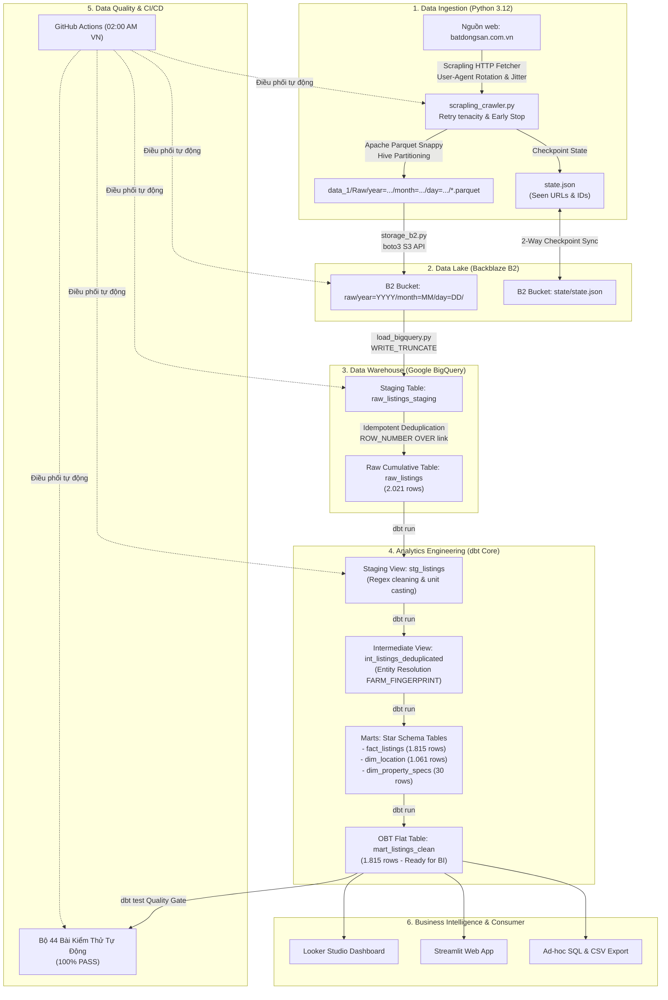

# BÁO CÁO KỸ THUẬT TOÀN DIỆN (TECHNICAL ARCHITECTURE & ENGINEERING DEEP-DIVE)
## HCMC Real Estate Modern Data Platform & Full-Stack Analytics (DE + DA)

> **Tài liệu học tập & Đúc kết kỹ thuật dành cho sinh viên và Junior Data Engineer / Analytics Engineer**  
> *Dự án:* Nền tảng dữ liệu thị trường Bất động sản TP.HCM  
> *Mã nguồn:* [github.com/Loc2116/Hcmc-Real-estate-Analytic-engineer](https://github.com/Loc2116/Hcmc-Real-estate-Analytic-engineer)  
> *Cập nhật:* Tháng 11/2026 · *Phiên bản:* 4.2 Production  

---

## MỤC LỤC
1. [Lời Mở Đầu: Chuyển Dịch Tư Duy Từ Academic Data Science Sang Production Data Engineering](#1-lời-mở-đầu-chuyển-dịch-tư-duy-từ-academic-data-science-sang-production-data-engineering)
2. [Kiến Trúc Tổng Thể Modern ELT Platform](#2-kiến-trúc-tổng-thể-modern-elt-platform)
3. [Tầng Data Ingestion: Nghệ Thuật Cào Dữ Liệu Chống Gãy & Kháng Chặn](#3-tầng-data-ingestion-nghệ-thuật-cào-dữ-liệu-chống-gãy--kháng-chặn)
4. [Tầng Data Lake: Backblaze B2 & Chuẩn Định Dạng Apache Parquet](#4-tầng-data-lake-backblaze-b2--chuẩn-định-dạng-apache-parquet)
5. [Tầng Data Warehouse: Tính Lũy Đẳng (Idempotency) Trên Google BigQuery](#5-tầng-data-warehouse-tính-lũy-đẳng-idempotency-trên-google-bigquery)
6. [Tầng Data Transformation: Medallion Architecture & Entity Resolution Với dbt](#6-tầng-data-transformation-medallion-architecture--entity-resolution-với-dbt)
7. [Mô Hình Hóa Dữ Liệu Kimball Star Schema & One Big Table (OBT)](#7-mô-hình-hóa-dữ-liệu-kimball-star-schema--one-big-table-obt)
8. [Data Quality Gates: Bộ 44 Kiểm Thử Toàn Vẹn Tự Động](#8-data-quality-gates-bộ-44-kiểm-thử-toàn-vẹn-tự-động)
9. [Điều Phối CI/CD Tự Động Với GitHub Actions](#9-điều-phối-cicd-tự-động-với-github-actions)
10. [Góc Phỏng Vấn (Interview Cheat Sheet): Trả Lời Nhà Tuyển Dụng Như Một Senior](#10-góc-phỏng-vấn-interview-cheat-sheet-trả-lời-nhà-tuyển-dụng-như-một-senior)
11. [Thuật Ngữ Kỹ Thuật Cốt Lõi (Glossary)](#11-thuật-ngữ-kỹ-thuật-cốt-lõi-glossary)

---

## 1. LỜI MỞ ĐẦU: CHUYỂN DỊCH TƯ DUY TỪ ACADEMIC DATA SCIENCE SANG PRODUCTION DATA ENGINEERING

Trong môi trường đại học, phần lớn sinh viên tiếp cận dữ liệu theo quy trình học thuật:
1. Tải một file `data.csv` có sẵn từ Kaggle hoặc dùng Selenium cào một lần duy nhất về máy.
2. Mở Jupyter Notebook, dùng Pandas xử lý missing value, chạy vài biểu đồ đơn giản.
3. Đưa vào scikit-learn / XGBoost để tối ưu điểm Accuracy / F1-Score.

Tuy nhiên, **trong môi trường doanh nghiệp thực tế, 80% giá trị của dữ liệu nằm ở khâu vận hành hạ tầng (Infrastructure & Data Lifecycle)**:
- *Dữ liệu hôm nay đúng, nhưng ngày mai web đổi giao diện hoặc có tin rác thì hệ thống có sập không?*
- *Nếu mạng chập chờn giữa chừng, dữ liệu đã cào có bị mất sạch không?*
- *Chạy lại pipeline 2 lần có làm nhân đôi doanh thu/số lượng tin trong báo cáo của Giám đốc không?*
- *Nhiều môi giới cùng rao bán 1 căn nhà với các mức giá khác nhau thì làm sao biết đâu là giá trị thực?*

Dự án này được thiết kế để giải quyết toàn bộ các câu hỏi hóc búa trên, chuyển dịch từ **"làm đồ án một lần rồi bỏ"** sang **"xây dựng nền tảng dữ liệu vận hành tự động 24/7 chuẩn công nghiệp"**.

---

## 2. KIẾN TRÚC TỔNG THỂ MODERN ELT PLATFORM

Dự án áp dụng mô hình **ELT hiện đại (Extract - Load - Transform)** thay cho mô hình ETL cổ điển:
- **E (Extract):** Thu thập dữ liệu tăng trưởng (Incremental) từ nguồn web `batdongsan.com.vn`.
- **L (Load):** Nạp dữ liệu thô nguyên bản vào **Data Lake (Backblaze B2)** và kho dữ liệu phân tích **Data Warehouse (Google BigQuery)** trước khi biến đổi.
- **T (Transform):** Sử dụng sức mạnh điện toán song song cực lớn của BigQuery thông qua công cụ mô hình hóa dữ liệu hàng đầu thế giới: **dbt (data build tool)**.

### Sơ đồ kiến trúc luồng dữ liệu toàn trình:



---

## 3. TẦNG DATA INGESTION: NGHỆ THUẬT CÀO DỮ LIỆU CHỐNG GÃY & KHÁNG CHẶN

Tệp tin chịu trách nhiệm: [scrapling_crawler.py](file:///c:/Users/ADMIN/Downloads/hcmc-real-estate-price-classification-main/scrapling_crawler.py) & [Module/01_data_collection/scrapling_crawler.py](file:///c:/Users/ADMIN/Downloads/hcmc-real-estate-price-classification-main/Module/01_data_collection/scrapling_crawler.py)

### 3.1. Tại sao loại bỏ hoàn toàn Selenium?
Nhiều bạn sinh viên quen dùng Selenium vì dễ học. Nhưng trong môi trường production/CI/CD (như GitHub Actions runner):
- Selenium bắt buộc phải cài đặt trình duyệt Chrome và chromedriver tương ứng $\rightarrow$ Rất nặng, tốn 1–2GB RAM, thường xuyên lỗi lệch version giữa Chrome và Driver.
- Selenium render toàn bộ JavaScript, CSS, hình ảnh $\rightarrow$ Tốc độ cào cực chậm (mất 5–10 giây cho 1 trang).
- Dự án thay thế bằng **`Scrapling` kết hợp TLS Fingerprint Impersonation**: Chỉ tải HTML tĩnh với tốc độ nhanh gấp **15–20 lần**, tiêu tốn dưới 50MB RAM.

### 3.2. Cơ chế Thử lại hàm mũ kết hợp Nhiễu ngẫu nhiên (Exponential Backoff with Jitter)
Khi cào web, mạng chập chờn hoặc máy chủ web phản hồi mã `HTTP 429 Too Many Requests` hoặc `503 Service Unavailable` là chuyện tất yếu. Nếu chương trình lập tức crash thì toàn bộ công sức cào trước đó sẽ đổ sông đổ bể.
Dự án sử dụng thư viện `tenacity` cấu hình retry tự động:

```python
@retry(
    stop=stop_after_attempt(4),
    wait=wait_exponential(multiplier=1.0, min=2.0, max=10.0) + wait_random(0.5, 1.5),
    retry=retry_if_exception_type((RetryableHTTPError, ConnectionError, TimeoutError, OSError)),
    reraise=True,
    before_sleep=_log_retry_attempt,
)
def fetch_page_with_retry(url: str, ...) -> Any:
    ...
```
- **Lần 1 thất bại:** Chờ $\approx 2\text{s} + \text{jitter}$.
- **Lần 2 thất bại:** Chờ $\approx 4\text{s} + \text{jitter}$.
- **Lần 3 thất bại:** Chờ $\approx 8\text{s} + \text{jitter}$.
- Khái niệm **Jitter (nhiễu ngẫu nhiên 0.5s - 1.5s)** ngăn hiện tượng "Thundering Herd" (nhiều tiến trình cùng gửi request vào đúng một thời điểm).

### 3.3. Cơ chế Cào Tăng Trưởng (Incremental Crawling) & Early Stopping
Không bao giờ cào lại những tin đã cào!
- Lớp `IncrementalStateManager` quản lý tệp [state.json](file:///c:/Users/ADMIN/Downloads/hcmc-real-estate-price-classification-main/state.json) lưu danh sách băm của `seen_urls` và `seen_ids`.
- Trước khi truy cập chi tiết 1 bài đăng, hàm `state.is_seen(url)` kiểm tra ngay trong $O(1)$ thời gian.
- **Early Stopping thông minh (`--early-stop 30`):** Do các tin đăng mới nhất luôn nằm ở trang đầu, nếu duyệt qua 30 tin liên tiếp mà toàn là tin cũ đã có trong kho $\rightarrow$ crawler tự động hiểu rằng hôm nay không còn tin mới nữa và **dừng ngay lập tức**, không quét các trang sau để tiết kiệm băng thông.

### 3.4. Ghi nguyên tử (Atomic Write) & Bảo toàn dữ liệu khi có sự cố
Để chống lỗi "Corrupted File" nếu máy chủ bị mất điện đột ngột hoặc người dùng bấm `Ctrl+C`:
- Dữ liệu luôn được ghi ra một tệp tạm `.tmp`.
- Chỉ khi tệp tạm được ghi xong 100% và chạy lệnh `os.fsync()`, hệ điều hành mới thực hiện lệnh `os.replace(temp_file, target_file)`. Thao tác đổi tên trên hệ điều hành là **Atomic** (chỉ có thành công trọn vẹn hoặc thất bại, không bao giờ sinh ra file dở dang).
- Toàn bộ việc lưu dữ liệu được đặt trong khối `try ... finally:` đảm bảo dù sập ở đâu thì dữ liệu đã cào trước thời điểm đó vẫn được lưu.

---

## 4. TẦNG DATA LAKE: BACKBLAZE B2 & CHUẨN ĐỊNH DẠNG APACHE PARQUET

Tệp tin chịu trách nhiệm: [storage_b2.py](file:///c:/Users/ADMIN/Downloads/hcmc-real-estate-price-classification-main/storage_b2.py)

### 4.1. Tại sao dùng Apache Parquet nén Snappy thay vì CSV?
Nhiều bạn thắc mắc: *"CSV mở bằng Excel được, tại sao kỹ sư dữ liệu lại chuộng Parquet?"*

| Tiêu chí | CSV (Comma-Separated Values) | Apache Parquet (Snappy) | Lợi thế cho Data Platform |
|---|---|---|---|
| **Cấu trúc lưu trữ** | Theo dòng (Row-oriented, dạng text) | Theo cột (Columnar-oriented, binary) | Parquet đọc nhanh hơn hàng chục lần khi chỉ cần truy vấn một số cột. |
| **Dung lượng nén** | Rất lớn, không nén hoặc nén thô (gzip) | Tự động nén dictionary + Snappy | Tiết kiệm **70% - 85% dung lượng lưu trữ**. |
| **Bảo toàn kiểu dữ liệu (Schema)** | Mất kiểu: Mọi thứ là text, khi đọc lại Pandas phải tự suy đoán kiểu (dễ lỗi đổi dấu chấm phẩy, lệch ngày tháng). | **Schema đi kèm metadata**: Cột nào là float64, string, timestamp đều được bảo toàn 100%. | Không bao giờ bị lỗi Schema Drift khi nạp vào Data Warehouse. |

### 4.2. Phân vùng Hive-Style (Hive-partitioned Data Lake)
Dữ liệu trên Backblaze B2 được tổ chức theo cấu trúc chuẩn công nghiệp của hệ sinh thái Hadoop/Hive:
```text
s3://hcmc-real-estate-price-classification/
├── raw/
│   ├── year=2026/
│   │   └── month=11/
│   │       ├── day=06/
│   │       │   └── listings_20261106_historical_backfill.parquet  (1.026 KB - 2.000 tin)
│   │       ├── day=12/
│   │       │   └── listings_20261112_214826.parquet              (28 KB)
│   │       └── day=13/
│   │           └── listings_20261113_215724.parquet              (39 KB)
└── state/
    └── state.json                                                 (378 KB - 2.021 URLs, 3.887 IDs)
```
- **Lợi ích Partition Pruning:** Khi cần truy vấn dữ liệu của tháng 11/2026, các công cụ Big Data (Spark, Trino, BigQuery) chỉ quét đúng thư mục `month=11` và bỏ qua hàng terabyte dữ liệu của các tháng khác, giúp giảm 90% chi phí truy vấn.

### 4.3. Giải pháp Đồng bộ Checkpoint trên Stateless Runner (2-Way State Sync)
Máy ảo GitHub Actions là môi trường **Stateless** (sau khi pipeline chạy xong, máy ảo sẽ bị Google Cloud/Azure xóa sổ hoàn toàn). Làm sao ngày mai máy ảo mới biết ngày hôm nay đã cào những gì?
- **Bước 1 (Pre-run):** Khi crawler khởi động, nó gọi hàm `state.sync_from_b2(b2_manager)` để tải `state/state.json` từ B2 về máy ảo.
- **Bước 2 (Running):** Cào và đánh dấu các tin mới thu thập.
- **Bước 3 (Post-run):** Hàm `finally:` gọi `state.upload_to_b2(...)` đẩy `state.json` mới nhất trở lại B2.
$\rightarrow$ Checkpoint được duy trì bền vững mà không cần phải chạy một cơ sở dữ liệu Redis hay PostgreSQL tốn kém!

---

## 5. TẦNG DATA WAREHOUSE: TÍNH LŨY ĐẲNG (IDEMPOTENCY) TRÊN GOOGLE BIGQUERY

Tệp tin chịu trách nhiệm: [load_bigquery.py](file:///c:/Users/ADMIN/Downloads/hcmc-real-estate-price-classification-main/load_bigquery.py)

### 5.1. Khái niệm cốt lõi: Tính Lũy Đẳng (Idempotency) là gì?
> **Định nghĩa:** Một tác vụ được gọi là **Lũy đẳng (Idempotent)** nếu việc thực thi tác vụ đó 1 lần hay 100 lần liên tiếp với cùng một dữ liệu đầu vào đều cho ra **chính xác một kết quả cuối cùng giống nhau**, không gây ra lỗi hay làm nhân đôi dữ liệu.

Nếu một pipeline nạp dữ liệu không có tính lũy đẳng:
- Chạy lần 1: Có 2.000 bản ghi.
- Ai đó vô tình bấm chạy lại lần 2: Bảng phình lên thành 4.000 bản ghi $\rightarrow$ Báo cáo doanh thu, giá trị thị trường bị nhân đôi $\rightarrow$ Thảm họa nghiệp vụ!

### 5.2. Cách giải quyết tương thích 100% với BigQuery Sandbox (Không mất phí)
Trong BigQuery tiêu chuẩn, người ta thường dùng câu lệnh DML `MERGE INTO`. Tuy nhiên, tài khoản **BigQuery Sandbox miễn phí** không cấp thẻ tín dụng sẽ giới hạn nhiều tính năng DML phức tạp.

Dự án áp dụng mẫu thiết kế 2 giai đoạn (Two-phase Staging Pattern):
1. **Giai đoạn 1 (Tải thô tạm thời):**
   Đọc toàn bộ các file Parquet từ B2 vào bảng tạm `raw_listings_staging` bằng cơ chế `WRITE_TRUNCATE` (xóa sạch bảng tạm rồi nạp lại).
2. **Giai đoạn 2 (Deduplication bằng Window Function):**
   Thực thi truy vấn tạo bảng chính thống thông qua hàm cửa sổ:
   ```sql
   CREATE OR REPLACE TABLE `hcmc_real_estate.raw_listings` AS
   SELECT * EXCEPT(row_num)
   FROM (
       SELECT 
           *,
           ROW_NUMBER() OVER (PARTITION BY link ORDER BY crawled_at DESC) as row_num
       FROM `hcmc_real_estate.raw_listings_staging`
   )
   WHERE row_num = 1;
   ```
- `PARTITION BY link`: Gom tất cả các bản ghi có cùng đường dẫn bài đăng vào một nhóm.
- `ORDER BY crawled_at DESC`: Đưa bản ghi được cào ở thời điểm mới nhất lên đầu nhóm (`row_num = 1`).
- `WHERE row_num = 1`: Chỉ giữ lại duy nhất bản ghi mới nhất, loại bỏ hoàn toàn các bản ghi cũ hoặc trùng lặp.
- **Xóa bảng tạm:** `DROP TABLE raw_listings_staging` để giải phóng tài nguyên.

---

## 6. TẦNG DATA TRANSFORMATION: MEDALLION ARCHITECTURE & ENTITY RESOLUTION VỚI DBT

Thư mục chịu trách nhiệm: [dbt_hcmc_real_estate/](file:///c:/Users/ADMIN/Downloads/hcmc-real-estate-price-classification-main/dbt_hcmc_real_estate/)

### 6.1. Kiến Trúc Medallion (Huy Chương)
Hệ thống biến đổi dữ liệu được chia làm 3 tầng ranh giới rõ ràng:
1. **Bronze Layer (Staging — `stg_listings.sql` - Materialized: `view`):**
   - Làm sạch chuỗi bằng Regex: Chuyển chuỗi `"18,5 tỷ"` $\rightarrow$ `18.5` (số thực), `"95.2 m²"` $\rightarrow$ `95.2`.
   - Tính toán đơn giá thị trường chuẩn xác: $\text{price\_per\_m2} = \text{price\_billion\_vnd} \times 1000 / \text{area\_m2}$.
   - Tách địa giới hành chính bằng Regex: Tách chuỗi địa chỉ thành `district` (Quận), `ward` (Phường), `street` (Đường).
   - Phân loại đường: `Mặt tiền`, `Hẻm ô tô`, `Hẻm xe máy`, `Chưa xác định`.
2. **Silver Layer (Intermediate — `int_listings_deduplicated.sql` - Materialized: `view`):**
   - Nơi xử lý bài toán kỹ thuật dữ liệu nâng cao: **Entity Resolution (Giải quyết thực thể)**.
3. **Gold Layer (Marts — Materialized: `table`):**
   - Mô hình hóa theo chuẩn Kimball Star Schema phục vụ trực tiếp cho báo cáo và BI.

### 6.2. Kỹ Thuật Entity Resolution (Khử trùng chéo môi giới)
Trong thị trường BĐS Việt Nam, một căn nhà có thể có **5 môi giới cùng đăng bài** trên `batdongsan.com.vn` với tiêu đề khác nhau, tài khoản khác nhau và ngày đăng khác nhau để câu khách. Nếu đếm từng tin đăng làm một căn nhà, toàn bộ thống kê về nguồn cung và mật độ nhà đất sẽ bị sai lệch hoàn toàn.

**Giải pháp thuật toán của dự án:**
Sinh ra một "Dấu vân tay bất động sản" (`property_fingerprint`) dựa trên các thuộc tính vật lý không thể thay đổi của căn nhà:
```sql
FARM_FINGERPRINT(
    CONCAT(
        COALESCE(LOWER(TRIM(district)), ''), '|',
        COALESCE(LOWER(TRIM(ward)), ''), '|',
        COALESCE(LOWER(TRIM(street)), ''), '|',
        COALESCE(CAST(ROUND(area_m2, 1) AS STRING), ''), '|',
        COALESCE(CAST(ROUND(price_billion_vnd, 2) AS STRING), '')
    )
) AS property_fingerprint
```
- Nếu 2 tin đăng khác nhau về URL nhưng có cùng Quận, cùng Phường, cùng Đường, cùng Diện tích và cùng Giá $\rightarrow$ Chúng sẽ sinh ra chung một `property_fingerprint` duy nhất!
- Nhóm lại bằng `GROUP BY property_fingerprint` và tính hàm `COUNT(link) AS duplicate_broker_count`.
- **Kết quả thực tế:** Từ **2.021 tin đăng thô**, hệ thống đã phát hiện ra chính xác **1.815 căn nhà vật lý thực sự**. Cột `duplicate_broker_count` trở thành một chỉ số giá trị biểu thị "độ thanh khoản / độ nóng" của căn nhà trên thị trường.

---

## 7. MÔ HÌNH HÓA DỮ LIỆU KIMBALL STAR SCHEMA & ONE BIG TABLE (OBT)

### 7.1. Cấu trúc Star Schema (Mô hình sao chuẩn Kimball)

```text
┌─────────────────────────────────┐
│          dim_location           │
├─────────────────────────────────┤
│ PK  location_key                │
│     district                    │
│     ward                        │
│     street                      │
└────────────────┬────────────────┘
                 │ 1:N
                 │
┌────────────────┴────────────────┐          ┌──────────────────────────────────┐
│          fact_listings          │   N:1    │        dim_property_specs        │
├─────────────────────────────────┤──────────┤──────────────────────────────────┤
│ PK  listing_id                  │          │ PK  property_spec_key            │
│ FK  location_key                │          │     lane_type                    │
│ FK  property_spec_key           │          │     legal_status                 │
│     link / listing_url          │          │     furniture_status             │
│     crawled_at / crawled_date   │          └──────────────────────────────────┘
│     price_billion_vnd           │
│     area_m2                     │
│     price_per_m2                │
│     lane_width_m                │
│     frontage_m                  │
│     floors / bedrooms/bathrooms │
│     duplicate_broker_count      │
│     is_lane_type_missing        │
│     is_lane_width_missing       │
└─────────────────────────────────┘
```

1. **`fact_listings` (Bảng Sự kiện):** Lưu trữ các sự kiện đo lường nghiệp vụ (Measures: Giá tiền, diện tích, số tầng, số phòng, độ rộng hẻm) và các khóa ngoại (Foreign Keys).
2. **`dim_location` (Bảng Thứ nguyên Vị trí):** Lưu trữ thông tin địa giới hành chính (Quận, Phường, Tên đường). Khóa chính `location_key` là Surrogate Key được băm từ chuỗi địa chỉ.
3. **`dim_property_specs` (Bảng Thứ nguyên Quy cách):** Lưu trữ các thuộc tính phân loại (Loại hẻm, Tình trạng pháp lý như Sổ hồng/Sổ đỏ, Nội thất).

### 7.2. Bảng Phẳng Hợp Nhất: `mart_listings_clean` (One Big Table - OBT)
- **Tại sao cần OBT?** Trong khi Star Schema tối ưu cho việc lưu trữ, quản trị dữ liệu và truy vấn OLAP nhiều chiều của Data Warehouse, thì các công cụ Trực quan hóa hiện đại (Looker Studio, Tableau, Power BI) và Data Analysts lại thích làm việc với một bảng phẳng duy nhất (One Big Table) để không phải viết lệnh `JOIN` phức tạp.
- View/Table `mart_listings_clean` thực hiện sẵn phép `LEFT JOIN` giữa `fact_listings` với 2 bảng `dim_*`, cung cấp sẵn **25 cột dữ liệu sạch chuẩn tiếng Anh `snake_case`**, phục vụ tải CSV hoặc kết nối Dashboard trong 1 cú click chuột.

---

## 8. DATA QUALITY GATES: BỘ 44 KIỂM THỬ TOÀN VẸN TỰ ĐỘNG

Thư mục chịu trách nhiệm: [dbt_hcmc_real_estate/tests/](file:///c:/Users/ADMIN/Downloads/hcmc-real-estate-price-classification-main/dbt_hcmc_real_estate/tests/) & các file `schema.yml`

Trong kỹ thuật dữ liệu, châm ngôn hàng đầu là: **"Garbage In, Garbage Out"** (Nếu đầu vào là rác thì kết quả báo cáo phân tích cũng chỉ là rác). Để bảo vệ người dùng và Dashboard, dự án thiết lập hàng rào kiểm thử tự động gồm **44 tests (100% PASS)**:

### 8.1. Kiểm thử tổng quát (Generic Tests trong `schema.yml`):
- **`unique`:** Đảm bảo 100% không có sự trùng lặp trên các khóa chính (`listing_id`, `location_key`, `property_spec_key`, `link`).
- **`not_null`:** Tuyệt đối không cho phép giá trị rỗng ở các chỉ số quyết định sống còn của mô hình (`price_billion_vnd`, `area_m2`, `price_per_m2`).
- **`relationships` (Toàn vẹn khóa ngoại):** Đảm bảo mọi bản ghi trong `fact_listings` đều trỏ tới một bản ghi có thực trong bảng `dim_location` và `dim_property_specs` (không có khóa ngoại mồ côi - orphan keys).
- **`accepted_values`:** Ràng buộc giá trị hợp lệ, ví dụ `lane_type` chỉ được phép nhận 1 trong 4 giá trị: `['Mặt tiền', 'Hẻm ô tô', 'Hẻm xe máy', 'Chưa xác định']`.

### 8.2. Kiểm thử logic nghiệp vụ (Singular Tests viết bằng SQL):
- **[assert_positive_price_and_area.sql](file:///c:/Users/ADMIN/Downloads/hcmc-real-estate-price-classification-main/dbt_hcmc_real_estate/tests/assert_positive_price_and_area.sql):**
  Kiểm tra không bao giờ tồn tại bản ghi có giá tiền hoặc diện tích $\le 0$.
- **[assert_valid_hcmc_price_range.sql](file:///c:/Users/ADMIN/Downloads/hcmc-real-estate-price-classification-main/dbt_hcmc_real_estate/tests/assert_valid_hcmc_price_range.sql):**
  Bắt và loại bỏ các giá trị dị biệt (outliers phi lý) trên thị trường BĐS TP.HCM: Diện tích bắt buộc nằm trong khoảng $[10, 2000]\text{ m}^2$, đơn giá thị trường nằm trong khoảng $[10, 1000]\text{ triệu VNĐ/m}^2$.

Nếu bất kỳ bài test nào trong số 44 bài test này bị `FAIL`, tiến trình CI/CD sẽ lập tức dừng lại, gửi cảnh báo đỏ và ngăn không cho dữ liệu lỗi được đẩy ra Dashboard.

---

## 9. ĐIỀU PHỐI CI/CD TỰ ĐỘNG VỚI GITHUB ACTIONS

Tệp tin chịu trách nhiệm: [.github/workflows/elt_pipeline.yml](file:///c:/Users/ADMIN/Downloads/hcmc-real-estate-price-classification-main/.github/workflows/elt_pipeline.yml)

Hệ thống vận hành hoàn toàn không cần can thiệp của con người (Zero-maintenance Serverless Pipeline):
1. **Lập lịch tự động (Schedule Cron):**
   ```yaml
   on:
     schedule:
       - cron: '0 19 * * *'  # 19:00 UTC = 02:00 Sáng giờ Việt Nam (UTC+7)
   ```
   Lựa chọn 02:00 sáng là giờ vàng vì lúc này lượng truy cập vào trang batdongsan.com.vn thấp nhất, không gây ảnh hưởng đến máy chủ web và ít bị hệ thống phòng thủ kích hoạt hạn chế truy cập.
2. **Kích hoạt thủ công (`workflow_dispatch`):**
   Cho phép người dùng bấm nút **Run workflow** trên web GitHub và điều chỉnh số lượng tin cào tùy ý (`crawler_samples`, mặc định `300`).
3. **Bảo mật tuyệt đối (Zero Credential Leakage):**
   - 100% thông tin nhạy cảm (Key Backblaze B2, Service Account Key JSON của Google Cloud) được mã hóa bằng **GitHub Actions Secrets**.
   - Cuối phiên chạy, step `Cleanup Credentials` với điều kiện `if: always()` sẽ xóa sạch tệp key trung gian trên máy ảo để ngăn chặn rò rỉ thông tin.

---

## 10. GÓC PHỎNG VẤN (INTERVIEW CHEAT SHEET): TRẢ LỜI NHÀ TUYỂN DỤNG NHƯ MỘT SENIOR

Khi nhà tuyển dụng phỏng vấn về dự án này, đây là cách bạn trình bày để thể hiện tư duy vượt trội so với các ứng viên sinh viên thông thường:

### Câu hỏi 1: "Tại sao em chọn mô hình ELT thay vì ETL truyền thống?"
> **Gợi ý trả lời:**  
> *"Dạ, trong mô hình ETL truyền thống, dữ liệu bị biến đổi (Transform) trên máy chủ trung gian trước khi nạp vào kho. Điều này gây ra 2 nhược điểm lớn: Thứ nhất, nếu logic biến đổi bị sai hoặc phát sinh yêu cầu mới, chúng ta phải cào lại toàn bộ dữ liệu nguồn từ đầu vì dữ liệu thô không được lưu lại. Thứ hai, máy chủ ETL dễ trở thành điểm nghẽn cổ chai (bottleneck).*  
> *Em chọn kiến trúc ELT: Thu thập dữ liệu thô và nạp ngay vào Backblaze B2 Data Lake và BigQuery Raw Table (Extract & Load). Sau đó, em tận dụng sức mạnh tính toán song song cực lớn của BigQuery cùng công cụ dbt để biến đổi (Transform). Nhờ đó, dữ liệu thô luôn được bảo toàn nguyên vẹn, em có thể thay đổi mô hình hoặc tái tính toán lịch sử bất cứ lúc nào mà không sợ mất mát dữ liệu."*

### Câu hỏi 2: "Làm thế nào em xử lý vấn đề trùng lặp dữ liệu (Deduplication) khi cào web mỗi ngày?"
> **Gợi ý trả lời:**  
> *"Dạ, em xử lý bài toán trùng lặp ở 3 tầng độc lập để đảm bảo an toàn tuyệt đối:*  
> *1. **Tầng Ingestion (Crawler):** Em dùng một state tracker lưu danh sách URL và ID đã cào vào `state.json`, đồng bộ 2 chiều với Data Lake B2. Trước khi gửi request, crawler kiểm tra trong $O(1)$ thời gian và dừng sớm (Early Stop) khi gặp 30 tin trùng liên tiếp.*  
> *2. **Tầng Data Warehouse (Idempotent Loader):** Trong script nạp BigQuery, em sử dụng staging table kết hợp hàm cửa sổ `ROW_NUMBER() OVER (PARTITION BY link ORDER BY crawled_at DESC) = 1`. Nhờ vậy, pipeline có tính lũy đẳng (Idempotency) — chạy 1 lần hay 10 lần thì dữ liệu trong kho vẫn duy nhất và không bị phình to.*  
> *3. **Tầng Nghiệp vụ (Entity Resolution):** Trong BĐS có hiện tượng nhiều môi giới cùng rao bán 1 căn nhà. Em dùng hàm băm `FARM_FINGERPRINT` trên các đặc trưng vật lý bất biến (Quận, Phường, Đường, Diện tích, Giá) để gộp các tin rao trùng thành một bất động sản thực tế duy nhất và sinh ra chỉ số đo lường độ hot `duplicate_broker_count`."*

### Câu hỏi 3: "Tại sao em lại tách dữ liệu thành Star Schema thay vì để nguyên một bảng phẳng?"
> **Gợi ý trả lời:**  
> *"Dạ, việc thiết kế theo chuẩn Kimball Star Schema mang lại 3 giá trị kỹ thuật to lớn:*  
> *1. **Chuẩn hóa và tiết kiệm chi phí lưu trữ:** Tách các thông tin lặp đi lặp lại như Tên Quận, Phường, Tên đường vào `dim_location` giúp tránh dư thừa dữ liệu (Data Redundancy).*  
> *2. **Data Governance & Tách biệt trách nhiệm:** Bảng sự kiện `fact_listings` chỉ tập trung lưu trữ các đại lượng đo lường (Measures) và các khóa thay thế (Surrogate Keys). Nếu sau này một phường sáp nhập hoặc đổi tên, em chỉ cần cập nhật duy nhất một bản ghi ở bảng Dim mà không phải sửa hàng triệu dòng ở bảng Fact.*  
> *3. **Tính linh hoạt:** Khi cần phục vụ BI Dashboard, em dựng view `mart_listings_clean` dạng One Big Table từ Star Schema, đáp ứng cả tiêu chuẩn quản trị kho dữ liệu lẫn sự tiện lợi cho người làm phân tích."*

---

## 11. THUẬT NGỮ KỸ THUẬT CỐT LÕI (GLOSSARY)

| Thuật ngữ | Ý nghĩa thực tế trong dự án |
|---|---|
| **ELT (Extract - Load - Transform)** | Mô hình thu thập, nạp thô vào kho trước rồi mới tận dụng điện toán đám mây để biến đổi dữ liệu. |
| **Idempotency (Tính lũy đẳng)** | Đặc tính đảm bảo việc chạy lại pipeline nhiều lần luôn cho ra cùng một kết quả duy nhất, không gây trùng lặp hay lỗi hệ thống. |
| **Hive Partitioning** | Quy ước đặt tên thư mục theo cấu trúc `key=value` (ví dụ: `year=2026/month=11/`) giúp các công cụ BigQuery/Spark chỉ quét đúng phân vùng cần tìm. |
| **Entity Resolution** | Thuật toán nhận diện và gộp các bản ghi dữ liệu khác nhau về định danh nhưng mô tả cùng một thực thể ngoài đời thực. |
| **Kimball Star Schema** | Phương pháp mô hình hóa dữ liệu chia thành Bảng sự kiện (Fact Table ở giữa) liên kết với các Bảng thứ nguyên (Dimension Tables xung quanh). |
| **Surrogate Key (Khóa thay thế)** | Khóa chính nhân tạo (thường là mã băm băm MD5 hoặc FarmFingerprint) thay thế cho khóa tự nhiên để độc lập với sự thay đổi của hệ thống nguồn. |
| **One Big Table (OBT)** | Bảng phẳng hợp nhất toàn bộ thông tin từ nhiều bảng, tối ưu cho tốc độ truy vấn phân tích của các công cụ Business Intelligence (Looker Studio, Power BI). |
| **Data Quality Gate** | Trạm kiểm soát chất lượng dữ liệu tự động; chặn đứng tiến trình và cảnh báo nếu dữ liệu không thỏa mãn các ràng buộc toàn vẹn. |

---
*Tài liệu được biên soạn phục vụ mục đích học tập, nghiên cứu kỹ thuật dữ liệu và chuẩn bị hồ sơ phỏng vấn chuyên nghiệp.*
